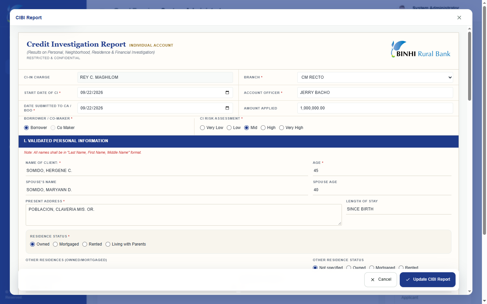

BRBI Credit Investigation Management System (BRBI CIMS)
BRBI CIMS is an internal web application developed for Binhi Rural Bank Inc. to help its Credit Investigation team organize applicant records, monitor investigation activities, and prepare official reports. It brings client folders, investigation findings, schedules, supporting documents, and reporting into a centralized workflow.
Key Features
- Client management: Client folders, applicant and co-maker information, and investigation progress tracking.
- Activity tracking: Credit investigation activities, scheduling, follow-ups, proof photos, and in-app reminders.
- Investigation reports: CI/BI reports, business and income-source reports, and residence and business checks.
- Document generation: PDF, DOCX, and Excel exports, depending on the report type.
- Administration: Dashboard, user roles, access controls, and system settings.

## Application Screenshots

### Dashboard

Tech Stack
Area	Technologies
Backend	PHP 8.3, Laravel 13
Frontend	Laravel Blade, JavaScript, Tailwind CSS v4
Database	MySQL
Build Tools	Vite 7, Composer, npm
Reports	dompdf, PHPWord, PhpSpreadsheet
Scheduling & Notifications	Laravel Task Scheduling, Artisan commands, database notifications
File Storage	Laravel filesystem, optional Cloudinary
Testing & Code Quality	PHPUnit 12, Laravel Pint

Developer & Project Information
- Developer: Rey C. Maghilom
- Role: Sole Full-Stack Developer
- Organization: Binhi Rural Bank Inc.
- Project Type: Professional workplace project
- Status: Completed
Developed as part of my employment at Binhi Rural Bank Inc. Public distribution or reuse of workplace code and bank materials requires appropriate authorization.
