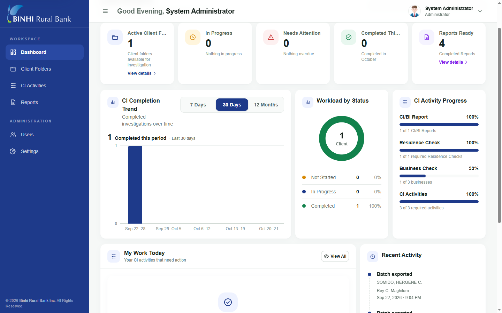
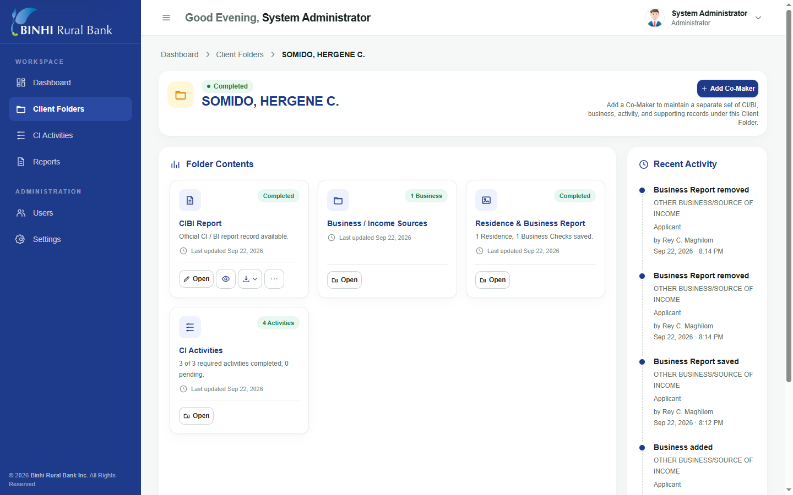
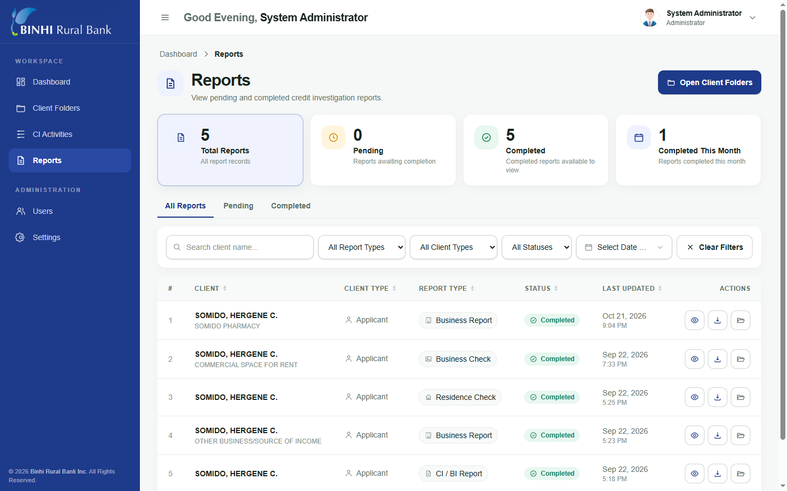
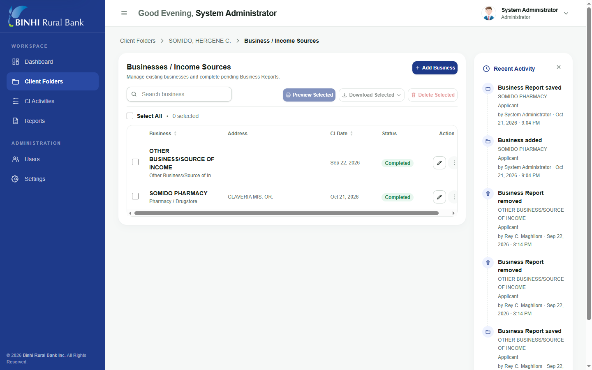

## BRBI Credit Investigation Management System (BRBI CIMS)
BRBI CIMS is an internal web application developed for Binhi Rural Bank Inc. to help its Credit Investigation team organize applicant records, monitor investigation activities, and prepare official reports. It brings client folders, investigation findings, schedules, supporting documents, and reporting into a centralized workflow.
## Key Features
- Client management: Client folders, applicant and co-maker information, and investigation progress tracking.
- Activity tracking: Credit investigation activities, scheduling, follow-ups, proof photos, and in-app reminders.
- Investigation reports: CI/BI reports, business and income-source reports, and residence and business checks.
- Document generation: PDF, DOCX, and Excel exports, depending on the report type.
- Administration: Dashboard, user roles, access controls, and system settings.

### Disclaimer — Demo Data & Privacy

All screenshots included in this repository are intended for demonstration and portfolio purposes only.

The information displayed in the screenshots consists of fictional or dummy data and does not represent actual customers, accounts, or confidential banking records.

The BRBI Credit Investigation Management System (CIMS) was developed as an internal application for Binhi Rural Bank Inc. The screenshots are provided solely to demonstrate the application's interface and functionality.

No real customer information, sensitive banking records, or production credentials are intentionally disclosed.
## Application Screenshots

### Dashboard

  

### Core Application Modules

| Client Folders | Client Management |
|:---:|:---:|
|  |  |

| Reports | Business Management |
|:---:|:---:|
|  |  |

## Technology Stack

| Category | Technologies |
|---|---|
| Backend | PHP 8.3, Laravel 13 |
| Frontend | Laravel Blade, JavaScript, Tailwind CSS v4 |
| Database | MySQL |
| Build Tools | Vite 7, Composer, npm |
| Reports & Exports | dompdf, PHPWord, PhpSpreadsheet |
| Scheduling & Notifications | Laravel Task Scheduling, Artisan Commands, Database Notifications |
| File Storage | Laravel Filesystem, Optional Cloudinary Integration |
| Testing & Code Quality | PHPUnit 12, Laravel Pint |
| Automation | N8n |

Developer & Project Information
- Developer: Rey C. Maghilom
- Role: Sole Full-Stack Developer
- Organization: Binhi Rural Bank Inc.
- Project Type: Professional workplace project
- Status: Completed
Developed as part of my employment at Binhi Rural Bank Inc. Public distribution or reuse of workplace code and bank materials requires appropriate authorization.
